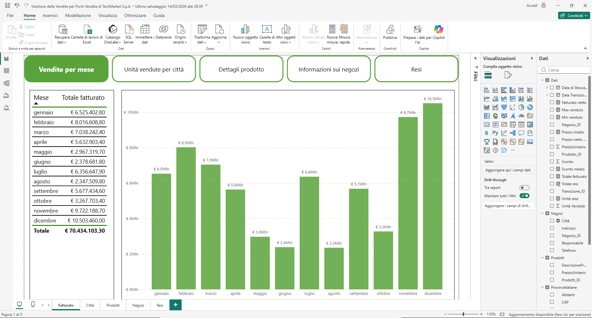
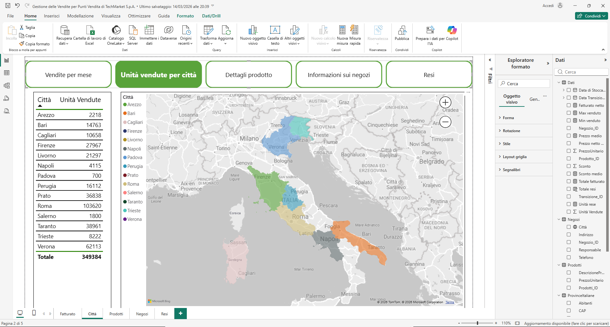
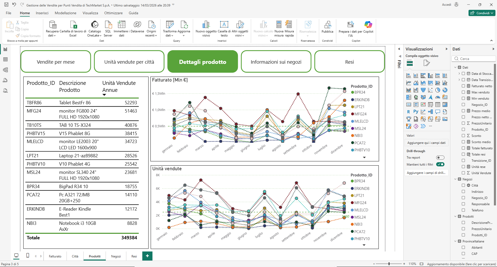
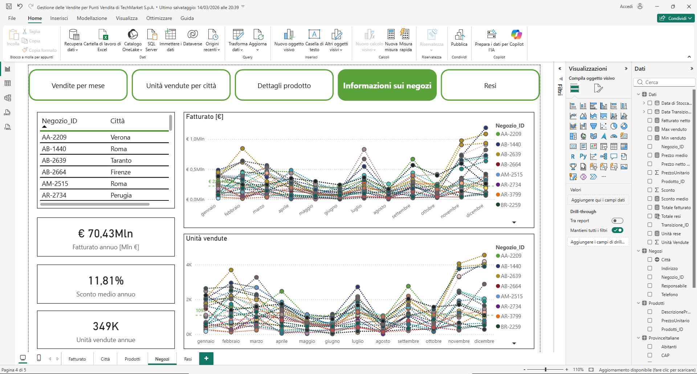
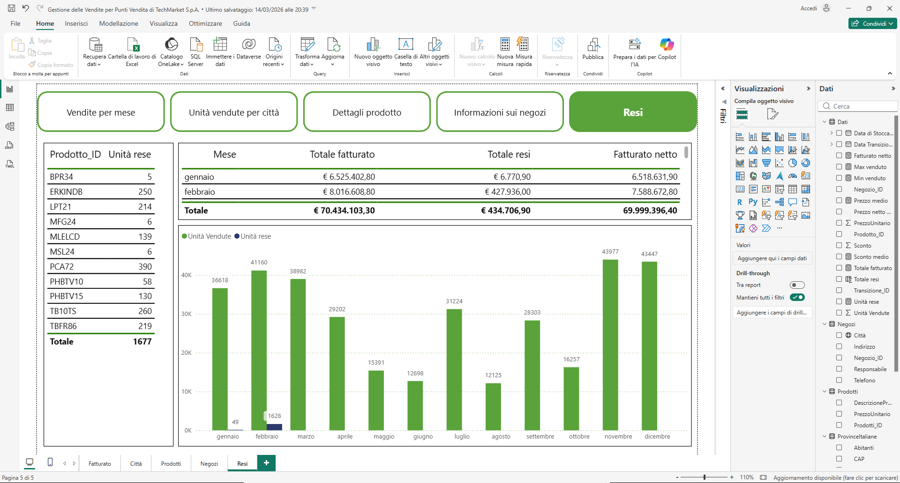

# 📊 Power BI - Sales Report in an Electronics Company
## 📌 Project Overview
This project focuses on developing an interactive sales reporting solution using Microsoft Power BI for a Italian electronics retail company, TechMarket S.p.A.

The company operates multiple retail stores across Italy and needs a reporting system to monitor sales performance, evaluate product performance, analyze discounts, and compare the results of individual stores.

The project involves importing, transforming, and integrating sales data with additional information about stores, products, and Italian provinces. An interactive Power BI report is then developed to provide business decision-makers with clear and detailed insights into the company's sales performance.

The report also incorporates return transactions to calculate net revenue, providing a more accurate representation of actual business performance.

## 🗂️ Dataset
The project uses three main categories of Excel datasets:

- **Sales Data (DATA/Sales_Data):** Monthly sales transactions from different retail stores during 2014.
- **Store Data (DATA/Store_Data):** Additional information about stores, products, and Italian provinces.
- **Returns Data (DATA/Returns_Data):** Information about returned products and transactions, used to calculate net revenue.
  
All datasets are provided in Excel format and organized into dedicated folders within the repository.

**Company:** TechMarket S.p.A. (fictional Italian electronics retail company).

**Geographical Coverage:** Multiple retail stores across Italy.

**Time Period:** January – December 2014 (sales data).

**Main Data:** Sales transactions, product information, store details, geographical information, and product returns.

## 🎯 Project Objectives
The main objectives of the project were:

- Monitor monthly sales performance, considering discounts, units sold, and product prices.
- Analyze sales distribution across the cities where the company operates.
- Evaluate the sales performance of individual products.
- Provide detailed insights into the performance of each retail store.
- Integrate return transactions to calculate net revenue and obtain a more accurate overview of business performance.
- Develop an interactive and user-friendly reporting solution.
- Improve data accessibility through interactive navigation, buttons, and bookmarks.

## 🛠️ Tools & Techniques
- Microsoft Power BI
- Power Query
- DAX (Data Analysis Expressions)
- Data Import and Transformation
- Data Cleaning
- Query Merging and Data Integration
- Data Modeling
- DAX Measures
- Sales Performance Analysis
- Revenue and Net Revenue Analysis
- Pricing and Discount Analysis
- Product Performance Analysis
- Retail Store Analysis
- Returns Management
- Data Visualization
- Interactive Dashboards
- Bookmarks and Navigation Buttons

## 📂 Project Structure
The Power BI report consists of five dedicated pages, each designed to analyze a specific aspect of TechMarket's sales performance.

Before developing the report, the source datasets were imported, cleaned, transformed, and integrated using Power Query.

## Data Preparation
The project involved two preliminary stages:

## 1. Data Import
The source datasets were imported from Excel files organized into three main categories:

- **Sales Data:** Monthly sales transactions from different retail stores during 2014.
- **Store Data:** Information about stores, products, and Italian provinces.
- **Returns Data:** Information about returned products and transactions.
  
## 2. Data Transformation and Integration
Power Query was used to prepare and integrate the datasets.

Key activities:

- Data cleaning and transformation.
- Merging queries to combine related information from different tables.
- Combining sales transactions with store and geographical information.
- Preparing the datasets for the Power BI data model.

## Report Pages
## 1. Monthly Sales Analysis
This page provides an overview of the company's monthly revenue throughout 2014.

Key analytical activities:

- Calculation of total revenue for each month.
- Presentation of monthly revenue through a summary table.
- Visualization of monthly revenue trends using a bar chart.

The page allows managers to monitor the company's monthly revenue and identify variations in sales performance throughout the year.

## 2. Sales Analysis by City
This page provides a geographical overview of sales volumes across the Italian cities where TechMarket operates.

Key analytical activities:

- Creation of a table displaying Italian cities and their corresponding total units sold.
- Geographical visualization of sales distribution across Italy using an interactive map.
- Comparison of sales volumes across different geographical locations.
- Identification of cities with higher sales volumes.

The combination of tabular data and geographical visualization allows managers to easily compare sales performance across Italian cities and identify the areas generating the highest sales volumes.

## 3. Product Performance Analysis
This page provides a detailed overview of individual product performance throughout the year.

Key analytical activities:

- Creation of a product table containing product names, descriptions, and total annual units sold.
- Monthly revenue analysis for each product using a line chart.
- Monthly sales volume analysis for each product using a second line chart.
- Comparison of product performance across the different months of 2014.

The two line charts allow managers to monitor monthly revenue and sales volume trends for individual products, helping identify seasonal patterns and changes in product demand.

## 4. Store Performance Analysis
This page provides a global overview of the performance of individual retail stores.

Key analytical activities:

- Creation of a store table containing store names and their respective cities.
- Analysis of annual revenue for each store.
- Calculation of average annual discounts by store.
- Monitoring of total units sold by individual store.
- Comparison of sales performance across retail locations.

This analysis allows managers to evaluate the performance of each store by considering revenue, discounts, and sales volumes.

## 5. Returns and Net Revenue Analysis
This page focuses on product returns and their impact on the company's actual sales performance.

Key analytical activities:

- Creation of a table showing returned units for each product.
- Presentation of total revenue, total returns, and net revenue.
- Calculation of net revenue by subtracting returned amounts from total revenue.
- Comparison of monthly units sold and returned units using a bar chart.

This page provides a more accurate overview of sales performance by considering the financial impact of returned products.

## Report Navigation and Interactivity
The report includes navigation features designed to improve usability and accessibility.

Key functionalities:

- Navigation buttons to move between report pages.
- Bookmarks to access specific report sections.
- Interactive navigation to facilitate data exploration.

These features provide a more intuitive reporting experience for both technical and non-technical users.

## 💡 Business Value
The Power BI reporting solution provides several potential business benefits:

- **Data-Driven Decision-Making:** Managers can access structured sales information to support strategic decisions and identify trends in product and geographical performance.

- **Sales and Promotional Optimization:** Analyzing discounts, prices, and sales volumes helps evaluate promotional effectiveness and identify opportunities to improve sales strategies.

- **Store Performance Monitoring:** Comparing individual retail locations provides insights into store-level performance and supports better resource allocation.

- **Returns Management:** Integrating return transactions allows the company to calculate net revenue and obtain a more accurate understanding of actual sales performance.

- **Interactive Reporting:** Navigation buttons and bookmarks improve report accessibility, making complex business information easier to explore and interpret.

## 🎓 Conclusion
This project demonstrates how Microsoft Power BI can be used to develop an interactive business intelligence solution for retail sales management.

By combining data import, transformation, integration, DAX calculations, and visualization, the report provides a structured overview of sales performance across different months, products, cities, and retail stores.

Including return transactions makes the analysis more complete, as it helps calculate net revenue and better understand the company's actual performance.

Overall, the project has strengthened my practical skills in Power BI, Power Query, DAX, data transformation and integration, business intelligence, and the development of interactive dashboards.

## 📁 Repository Contents
- **[PowerBI_Sales_Report_Electronics_Company.pbix](PowerBI_Sales_Report_Electronics_Company.pbix):** Power BI report containing the interactive dashboards, data model, DAX measures, and sales analysis.
- **DATA/:** Folder containing the original Excel datasets organized into three subfolders:
    - **[DATA/Sales_Data](DATA/Sales_Data):** Monthly sales transaction files.
    - **[DATA/Store_Data](DATA/Store_Data):** Store, product, and geographical information.
    - **[DATA/Returns_Data](DATA/Returns_Data):** Product returns data.
- **[images](images)** Folder containing screenshots of the five Power BI report pages.

## 📸 Project Preview
## 1. Monthly Sales Analysis
Monthly sales performance, including revenue, discounts, and units sold.

## 2. Sales Analysis by City
Geographical distribution of units sold across different cities.

## 3. Product Performance Analysis
Sales performance and detailed information about individual products.

## 4. Store Performance Analysis
Overview of sales performance across individual retail stores.

## 5. Returns and Net Revenue Analysis
Analysis of returned products and net revenue for January and February.

## 📬 Contact
- **Silvia Venturini**
- [LinkedIn](https://www.linkedin.com/in/silvia-venturini92/)
- **Email:** silvia.venturini92@hotmail.com
